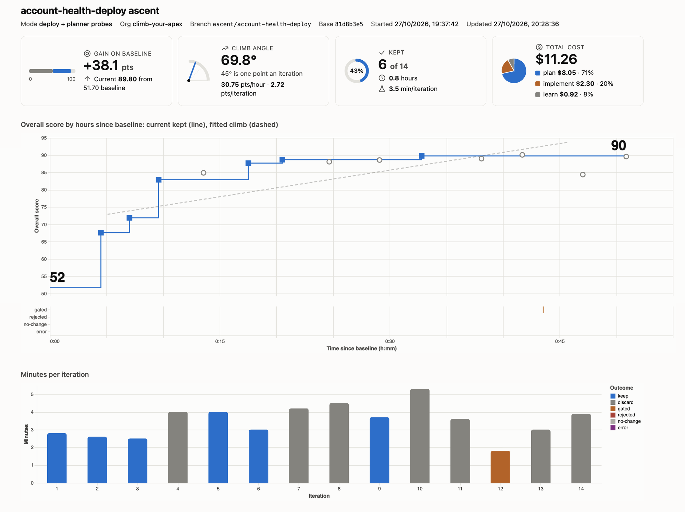

# Climber

Climber is a set of tools an AI agent uses to improve your Salesforce Apex code and tests. You point it at one or more classes and the agent tries one small change at a time.

Each change gets a score that combines weighted tools (dimensions) such as tests, code coverage, static analysis and governor limit use, and you configure which tools count and how much.

A change is kept only if the score goes up, so the code never gets worse. When the run ends you get a report of what changed and why. [How it works](doc/how-it-works.md) shows how ascents, iterations, steps and scoring fit together.

To decide where to climb, [mapping](doc/mapping.md) charts your Apex code as a treemap of groups of classes and tests. Each rectangle is sized by lines of code and coloured by its score, so a large red rectangle is a lot of code scoring poorly.

The out-of-the-box dimensions:

- PMD: static analysis violations
- Graph Engine: data flow and path analysis violations
- Tests passing
- Code coverage
- Test run time
- Limit headroom: governor limit use for one batch of 200 records
- Resource efficiency: governor limit use across the other tests

To try it, follow the [quick start](#quick-start) to climb the included sample classes in a scratch org.

[](https://nextdoc.github.io/climber/account-health-deploy.html)

The report of a deploy-mode ascent of the `AccountHealthRollup` sample class. Click the image for the full report.

To get a feel for climbing without touching your own code, climb the three included sample classes with your agent in a separate scratch org. Each has its own test, and all three use only the standard data model. The first two have deliberate weaknesses. You can also [map](doc/mapping.md) them in the same scratch org to see an interactive version of the scored treemap.

| Class | Test | Requirements | What it does |
|---|---|---|---|
| `AccountHealthRollup` | `AccountHealthRollupTest` | [doc/account-health-rollup.md](doc/account-health-rollup.md) | Rates accounts Hot, Warm or Cold and creates follow-up tasks. |
| `CaseSlaEscalation` | `CaseSlaEscalationTest` | [doc/case-sla-escalation.md](doc/case-sla-escalation.md) | Escalates open cases past their first response target in business hours, and assigns those on Hot accounts to the account owner. It reads the account Rating that `AccountHealthRollup` sets, so a climb over both classes can catch a change in one that breaks the other. |
| `ContactEmailNormalizer` | `ContactEmailNormalizerTest` | none | Trims and lowercases contact email addresses. It scores near 100, as a contrast on the sample map. |

The default ascent config, `ascent.config.json`, climbs the first two classes. Each class has its own headroom test and Streamline suite, scored on its own and averaged. `config/ascent.account-health-rollup.json` climbs `AccountHealthRollup` alone.

An Apex-only Salesforce DX project. There are no Lightning Web Components, Aura components, or other JavaScript code.

## Goals

- G1: Improve your code's performance across all of the weighted scoring dimensions.
- G2: At the end of an ascent, give a retrospective of the features and gaps in your business domain logic. It draws on the changes and optimisations made and on what the agent steps observed, in particular the learnings recorded throughout the ascent.
- G3: Improve correctness. The tool doesn't assume your code or tests are fully correct. An ascent exposes behaviour your tests don't pin and places where the code, tests or spec disagree, so you can fix them. See [doc/anchor.md](doc/anchor.md).
- G4: Improve code more reliably than an open-ended agent session, by making each practice below a property of the harness instead of something the agent has to remember. See [doc/benefits.md](doc/benefits.md) for how the tool delivers each one and the research behind it.
  1. [Small, focused agent context](doc/benefits.md#1-small-focused-agent-context)
  2. [Objective scoring, no self-grading](doc/benefits.md#2-objective-scoring-no-self-grading)
  3. [Kept improvements cannot be lost](doc/benefits.md#3-kept-improvements-cannot-be-lost)
  4. [Fresh attempts instead of commitment to one approach](doc/benefits.md#4-fresh-attempts-instead-of-commitment-to-one-approach)
  5. [Each iteration is an experiment](doc/benefits.md#5-each-iteration-is-an-experiment)
  6. [Protection against regressions](doc/benefits.md#6-protection-against-regressions)
  7. [Learning accumulates, context does not](doc/benefits.md#7-learning-accumulates-context-does-not)
  8. [Noise is not mistaken for progress](doc/benefits.md#8-noise-is-not-mistaken-for-progress)
  9. [Small, attributable changes](doc/benefits.md#9-small-attributable-changes)
  10. [Stop at any time](doc/benefits.md#10-stop-at-any-time)
  11. [Bounded, unattended runs](doc/benefits.md#11-bounded-unattended-runs)
  12. [Cheaper models, any agent CLI](doc/benefits.md#12-cheaper-models-any-agent-cli)
  13. [Progress at a glance](doc/benefits.md#13-progress-at-a-glance)
- G5: Maintain a vibrant community around this toolset and the ideas behind it. See [doc/community.md](doc/community.md) for the Slack invite and guidelines.
- G6: Make it clear where the tools move from read only to side effects, and what each side effect is. See [doc/is-it-safe.md](doc/is-it-safe.md) for each way of using climber, from the quick start to a deploy-mode ascent in a sandbox.

## Non-goals

- NG1: Guaranteeing that performance changes preserve your code's business behaviour. Your tests define the behaviour, and anything they don't cover can change.

## Installation

Prerequisites, with minimum versions where one matters and otherwise the version this repo is tested on:

| Tool | Version | Used for |
|---|---|---|
| [Bun](https://bun.sh) | 1.3 | Running the CLIs and tests |
| Node.js and npm | 22 | Installing the pinned dependencies |
| [Salesforce CLI](https://developer.salesforce.com/tools/salesforcecli) (`sf`) | 2+ | Deploying, testing and querying the org |
| Code Analyzer plugin | 5.0+ | PMD and Graph Engine scoring (`sf plugins install code-analyzer`). Version 4 used `sf scanner run`, which the scoring doesn't support |
| Java | 11 or later | Required by the PMD and Graph Engine engines |
| [Claude Code](https://claude.com/claude-code) (`claude`) | 2.1 | The default agent steps in `ascent.config.json` |

```sh
git clone https://github.com/nextdoc/climb-your-apex.git
cd climb-your-apex
npm ci
```

## Quick start

Climb the included sample classes and watch the report. Choose one of two configs:

- **One class (simpler).** `config/ascent.account-health-rollup.json` climbs `AccountHealthRollup` alone. The ascent in the image used this setup and took 14 iterations, 50 minutes and $11.26 in agent calls.
- **Both classes.** `ascent.config.json`, the default, climbs `AccountHealthRollup` and `CaseSlaEscalation` together. Expect more time and agent cost per iteration.

The steps below use the one-class config. For both classes, leave out `-c` and its file.

1. Follow the [installation](#installation) steps.
2. Create a scratch org for the samples, using your Dev Hub:

   ```sh
   sf org create scratch -f config/project-scratch-def.json -a climb-your-apex --target-dev-hub <dev hub alias>
   ```

3. Start an ascent. This scores the baseline and writes the report.

   ```sh
   bun cli/ascent-init.ts sample-1 -o climb-your-apex -c config/ascent.account-health-rollup.json
   open target/ascents/sample-1/report.html   # macOS. Use xdg-open on Linux or start on Windows.
   ```

4. Run iterations until the summary reports `"stop": true`. The report refreshes itself every minute, so you can watch the climb. To run them unattended, ask your agent to run the command repeatedly until it reports stop.

   ```sh
   bun cli/iterate.ts sample-1
   ```

The [Process](#process) section covers the retrospective and what to do after an ascent.

## Process

Instructions for an agent using this project. The terms are defined in the [glossary](doc/glossary.md).

1. Install the prerequisites above.
2. Start an ascent with `bun cli/ascent-init.ts <name> -o <org>`, adding `-c <config>` to climb a different set of classes. This scores the baseline. Open `target/ascents/<name>/report.html` in the operating system's default browser so the user can watch the climb.
3. Run `bun cli/iterate.ts <name>` repeatedly until its summary reports `stop`.
4. Write the retrospective with `bun cli/retro.ts <name>`, passing `-s <spec files>` when the project has a spec. In Streamline mode, run `bun cli/confirm.ts <name>` too.
5. Show the user the report at `target/ascents/<name>/report.html`, then ask which path to take. Anchoring is optional.
   - **Adopt.** Review the retrospective, merge the best kept commit, and adopt the learnings and proposed tests the user approves.
   - **Anchor.** Treat the first ascent as the scout ascent and run the [anchor](doc/anchor.md#anchor) steps to fix the tests, code and spec. Then start a new ascent from the improved baseline.

## Dependencies

The CLIs run on Bun and use these dependencies:

- `commander` - parses each CLI's arguments and options.
- `zod` - defines and validates the config, history, map and scores files.
- `@apexdevtools/apex-parser` - parses Apex to extract Streamline scenarios.
- `@modelcontextprotocol/sdk` - calls the Streamline MCP server to run anonymous Apex.

The dev dependencies are for formatting:

- `prettier` - code formatter.
- `prettier-plugin-apex` - formats Apex classes (`.cls`) and triggers (`.trigger`).
- `@prettier/plugin-xml` - formats Salesforce metadata XML.

The ESLint, Jest, and LWC tooling from the default Salesforce DX template was removed because the project has no JavaScript to lint or test.

## Pinned versions

Dependency versions are pinned to reduce supply chain risk. A version range would let a newly published, possibly compromised release install automatically.

- `package.json` lists exact versions, and `.npmrc` sets `save-exact=true` so new dependencies are also saved without a range.
- `package-lock.json` pins every transitive dependency with an integrity hash. Commit it.
- Install with `npm ci`, which installs exactly what the lockfile specifies and fails if it is out of sync with `package.json`.
- To upgrade, change a version deliberately, review the new release, then run `npm install` and commit the updated lockfile.

## Commands

- `npm ci` - install the pinned dependencies.
- `npm run prettier` - format all files.
- `npm run prettier:verify` - check formatting without writing changes.

## Documentation

| Document | Covers |
|---|---|
| [CLIs](doc/clis.md) | Each CLI's purpose, options and outputs. |
| [Glossary](doc/glossary.md) | The terms used across the tools and docs, such as ascent, iteration, dimension, margin and mode. |
| [Scoring](doc/scoring.md) | Each dimension's source, formula and half-score penalty, the overall score, and how inputs are collected. |
| [Mapping](doc/mapping.md) | Charting the codebase as a treemap of groups sized by lines and coloured by score, to choose what to climb. Early. |
| [Streamline](doc/streamline.md) | The two uses of Streamline: planner probes, and Streamline mode as a faster alternative to deploy mode. Draft. |
| [Caveats](doc/caveats.md) | Known limits on what the scores mean. |
| [Is it safe?](doc/is-it-safe.md) | Each way of using climber, from the quick start to an ascent in a sandbox, and what each changes in the org and the repo. |
| [Benefits](doc/benefits.md) | Why climb with a harness instead of one open-ended agent session, and the research behind each practice. |
| [Account Health Rollup](doc/account-health-rollup.md) | The requirements for the `AccountHealthRollup` sample class. |
| [Case SLA Escalation](doc/case-sla-escalation.md) | The requirements for the `CaseSlaEscalation` sample class. |
| [Anchor](doc/anchor.md) | The optional steps that fix tests, code and spec from a scout ascent's drift, and each sample's inventory of weaknesses, defects and gaps. |
| [Community](doc/community.md) | The Slack invite and community guidelines. |
| [Design](doc/design.md) | Ideas not yet built. |
| [References](doc/references.md) | Public research on agent loops and prompt optimisation that the project draws on. |

## Files overview

Each ascent creates two directories under `target/`, which git ignores. The worktree holds the code being improved, and the ascent directory records what happened.

```text
target/
├── worktrees/
│   └── <name>/                   git worktree on branch ascent/<name>: agents edit, deploy and test here
└── ascents/
    └── <name>/
        ├── ascent.json           this ascent's config, copied from ascent.config.json at init
        ├── history.jsonl         one entry per iteration: plan, scores, outcome, decision, learning, cost
        ├── report.html           the HTML report
        ├── retro.json            the retrospective, with coded items
        ├── retro/
        │   ├── prompt.md         the retro step's prompt
        │   └── agent.txt         the retro step's raw output
        ├── confirm.json          confirm's result for the start and best kept commits
        ├── confirm/
        │   ├── baseline/         the start commit's deploy-mode run
        │   └── best/             the best kept commit's deploy-mode run
        ├── anchor/
        │   ├── audit/            the audit's inputs and findings.json
        │   ├── verify/           the verify step's inputs and scenarios
        │   ├── findings.json     the findings with their verify status
        │   └── review.html       the page for deciding each finding
        ├── patches/
        │   └── <n>.patch         iteration n's candidate diff
        └── runs/
            └── <n>/              iteration n (0 is the baseline)
                ├── deploy.json        deploy result, the compile gate (deploy mode)
                ├── pmd.json           PMD violations
                ├── sfge.json          Graph Engine violations
                ├── tests.json         test results and coverage (deploy mode)
                ├── logs/              test debug logs, or one log per variant in Streamline mode, read for governor limit use
                ├── <variant>.apex     each composed Streamline script (Streamline mode)
                ├── streamline.json    each variant's compile and run outcome (Streamline mode)
                ├── extract-error.txt  why a class could not be adapted to anonymous Apex (Streamline mode)
                ├── prepare.log        output of cli/score-prepare.sh
                ├── <step>-prompt.md   the plan, implement and learn prompts
                ├── <step>.txt         each step's raw output
                ├── error.txt          stack trace when the iteration errored
                └── entry.json         the full history entry when it failed validation
```

A dimension with weight 0 skips its tool, so its file is absent. `confirm/`, `anchor/` and `retro/` exist only once those commands have run.

Each map has its own folder, `target/map/<name>/`, laid out in [Mapping](doc/mapping.md#output-naming).

## CLIs

Each CLI is one file under `cli/`, run with Bun from the repo root. [CLIs](doc/clis.md) has the options for each.

- [ascent-init](doc/clis.md#ascent-init) - start an ascent on its own branch and worktree, and score the baseline.
- [iterate](doc/clis.md#iterate) - run one iteration: plan, implement, score, keep or discard, then learn.
- [report](doc/clis.md#report) - rewrite the ascent's HTML report.
- [confirm](doc/clis.md#confirm) - deploy and score the start and best kept commits, to confirm a streamline ascent before merging.
- [retro](doc/clis.md#retro) - write a first-pass retrospective of an ascent.
- [anchor](doc/clis.md#anchor) - audit an ascent's drift, verify behaviour changes against the baseline, and review the findings. Applying the decisions is not built yet.
- [map](doc/clis.md#map) - gather, check, render and score a treemap of the codebase's groups, to choose which to climb.
- [score-prepare and score](doc/clis.md#score-prepare-and-score) - collect the raw tool output for a run, then score it.

## Influences

Climber was inspired by Andrej Karpathy's [autoresearch](https://github.com/karpathy/autoresearch), an agent loop that proposes a change, measures it and keeps it only if the metric improves.
