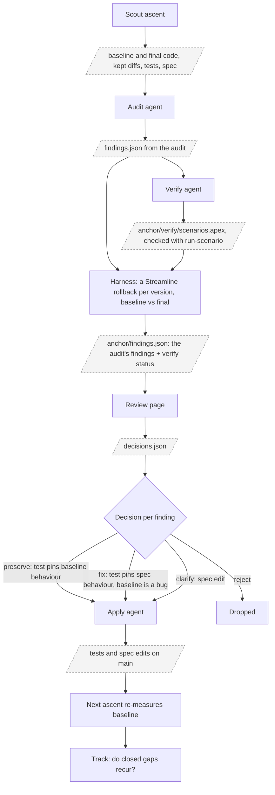

# Correctness

This tool cannot assume that the code it climbs or the tests that guard it are fully correct. Real code carries bugs and unwritten decisions, and real tests cover only some of its behaviour. So one of the tool's features is improving correctness itself: an ascent exposes where the code, the tests or the spec are incomplete or wrong, and that evidence drives fixes to them.

Scores measure code quality and resource use, not correctness. Correctness enters an ascent only through the tests, as a pass or fail gate. Any behaviour the tests do not pin is free for the climb to change, and it will change it when that raises a score.

Three sources describe what the code should do, and in real codebases any of them can be missing, incomplete or wrong:

- **Spec.** A written description of the intended behaviour. Often absent. Here it is `doc/account-health-rollup.md`.
- **Original code.** The code before the climb. It may contain bugs or decisions nobody wrote down.
- **Tests.** They pin only the behaviours someone thought to check.

Climbing exposes these weaknesses. A kept candidate that changes behaviour shows a gap in the tests, and comparing it with the spec shows whether the original code or the candidate is wrong. If the original code or the tests are wrong, the climb optimises towards a wrong target.

## Anchor

An anchor uses a scout ascent's drift to fix the tests, the code and the spec. It is optional. A user can start climbing without it, and any completed ascent can serve as the scout later. The inventory below was produced by hand this way, and an anchor automates it. The step names are defined in the [glossary](glossary.md#anchor).

**Maturity: early.** Audit, verify and review are implemented and have been run end to end on one sample ascent. Apply and Track are not built yet. Audit findings vary from run to run, particularly defects, spec gaps and test gaps, and verify skips findings that depend on users, sharing or org metadata. The prompts, finding kinds and decision options will probably change as users give feedback.

- **Audit.** The prompt is fixed and generic, so it works on any project. It is in [anchor-audit.md](../cli/prompts/anchor-audit.md). With a spec, each behaviour change is classified against it. With no spec, nothing says whether the baseline or the final code is right, so every behaviour change is raised as a spec gap for the user to answer.
- **Findings.** `findings.json` is validated with Zod, like the retro reply. Each finding has a code in one of the categories used below: B (behaviour change), D (defect against the spec), U (spec gap) and T (test gap). It also carries the evidence, the iterations involved, a proposed test with its seed data and expected result, and, after verify, a `verify` block added by the harness, with a status of reproduced, not reproduced, skipped or error and both outputs.
- **Verify.** A baseline oracle with a challenger. For each behaviour change, an agent writes seed data aimed at it, such as an Event, a contact task or another closed status. Two Streamline rollbacks, one per version, run a renamed copy of the baseline class and the final class on the same seed data, each with its own governor limits, and compares ratings, created tasks and field writes. It runs once after the ascent, so it adds no time to the ascent. The harness writes a copy of the audit's findings to `anchor/findings.json`, with a `verify` block on each behaviour change. A finding that does not reproduce stays in the copy with the status not reproduced, so the user can see what the audit claimed.
- **Review page.** A pre-built HTML template, like the ascent report, renders `findings.json` grouped by category, with evidence and verify status beside each finding.
- **Decide.** The user decides per finding on the review page, from the options its kind allows: B preserve, fix, clarify or reject; D fix or reject; U clarify, with the answer in a note, or reject; T add-test or reject. The page keeps the decisions in browser storage for one review at a time, keyed by a hash of the findings, so new findings start blank. A button copies them as JSON to paste into the chat, and the agent writes `decisions.json`. A local server that writes the file directly is deferred.

### Roadmap

**Behaviour guard.** An ascent after an anchor guards behaviour on every candidate, not only through the tests. Behaviour changes on purpose only in an anchor, so the guard is chosen at `ascent-init` and fixed for the ascent, like the mode: a `behaviour` field in `ascent.config.json`, overridable with `--behaviour`.

- **`strict`.** `iterate` gates each candidate with the baseline oracle, using the seed data verified in the last anchor. Any difference in output discards the candidate.
- **`judged`.** A candidate that fails the oracle goes to a spec-judge agent step, which keeps it only when the difference improves adherence to the spec. The judge's reasoning is recorded in the history for review after the ascent. `ascent-init` refuses `judged` without a spec.

## Sample inventories

Each sample class has a known list of weaknesses, defects and gaps, so an ascent or an audit can be checked against it. Codes are unique across the samples.

### Account Health Rollup

The original `AccountHealthRollup` was written as a naive baseline (commit `a06a7cb`), so its scoring weaknesses are deliberate. The correctness defects and gaps below were found by reviewing the ascents, and not all of them were planted. Line numbers refer to the original class on `main`.

#### Scoring weaknesses (deliberate)

| Code | Where | What |
|---|---|---|
| S1 | `AccountHealthRollup.cls:30` | Filter values are concatenated into dynamic SOQL (injection). |
| S2 | `:1` | No sharing declaration, no CRUD or FLS checks, no user mode. |
| S3 | `:84`, `:101` | Nested loops scan every opportunity and task for every account. |
| S4 | `:157`, `:167` | A query and an insert per account that needs follow-up. |
| S5 | `:25`, `:62`, `:72` | Unused fields in every SELECT. |
| S6 | `:34`, `:38`, `:111`, `:168` | `System.debug` calls. |
| S7 | `:55` | One long method with high cyclomatic and cognitive complexity. |

#### Defects against the spec

| Code | Where | What | Spec |
|---|---|---|---|
| D1 | `:93` | Open pipeline excludes only the stages named 'Closed Won' and 'Closed Lost', so a custom closed stage counts as pipeline. | "open opportunities" (`:21`) |
| D2 | `:157` | An open follow-up is any task whose status is not 'Completed', so a task closed with another status still blocks a new follow-up. | "an open task with the same subject" (`:47`) |
| D3 | `:157`, `:167` | One query and one insert per follow-up fail past about 100 follow-ups or 150 inserts in one run. | "up to every account in the org" (`:60`) |

#### Spec gaps

| Code | Question the spec leaves open |
|---|---|
| U1 | Hot rule grouping: "(won or pipeline) and recent activity", or "won, or (pipeline and recent activity)"? The code uses the first. |
| U2 | Is "same subject" case-sensitive? SOQL `=` is not. |
| U3 | Does a task closed with a status other than 'Completed' count as completed activity? |
| U4 | Should the run rate every account, or only those the running user can see and edit? |
| U5 | Does "last 12 months" mean 365 days, and does a won opportunity with a future close date count? |

#### Test gaps

| Code | Missing scenario | Ascent drift it would have caught |
|---|---|---|
| T1 | A completed Event on the account | `LastActivityDate`, `ActivityHistories` (streamline-1, trial-3, trial-4, streamline-2 #18) |
| T2 | A completed task on one of the account's contacts | `Task.AccountId`, `LastActivityDate` (streamline-2 #13, streamline-1, trial-4) |
| T3 | A task closed with a status other than 'Completed' | Same as T1, and D2 |
| T4 | An open Event or an open task with a similar subject | `OpenActivities` and `LIKE 'Re-engage %'` dedup (trial-3, trial-4, deploy-probes-1) |
| T5 | An opportunity in a custom closed stage | D1, and trial-4's `IsClosed = false` fix |
| T6 | Rating boundaries: exactly 100,000 won, 250,000 pipeline, 30 and 90 days | None observed yet |
| T7 | A run by a user without View All Data | `ActivityHistories`, `OpenActivities` restriction (trial-3, deploy-probes-1) |
| T8 | More than 200 accounts, and more than 100 follow-ups | D3, and dropping the 200-record chunks (all ascents) |
| T9 | An account whose Rating does not change | Skipping the update when Rating is unchanged (streamline-1) |

### Case SLA Escalation

`CaseSlaEscalation` was written as a more naive baseline than `AccountHealthRollup`, with every item below planted, except that the spec gaps were left open on purpose. Its tests pass and cover 96% of the class. Line numbers refer to the original class on `main`.

#### Scoring weaknesses (deliberate)

| Code | Where | What |
|---|---|---|
| S8 | `CaseSlaEscalation.cls:1` | No sharing declaration, no FLS checks and no user mode. |
| S9 | `:29` | The CRUD check calls `Schema.getGlobalDescribe()` once per case, about 14 ms each and most of the run's CPU. |
| S10 | `:15`, `:66`, `:70` | Dynamic SOQL where static SOQL would do. The account and user queries concatenate values into the query string (injection). |
| S11 | `:20` | Every CaseComment in the org is queried, with no filter. |
| S12 | `:46` | A nested loop scans every comment for every case past its target. |
| S13 | `:54`, `:66`, `:70` | Three queries per escalated case: the case again, its account, and the account owner. |
| S14 | `:62`, `:78`, `:80`, `:88` | Three updates and an insert per escalated case. |
| S15 | `:108` | Every open case is updated at the end of every run, whether it changed or not. |
| S16 | `:15`, `:21`, `:24`, `:54`, `:66`, `:70` | Unused fields in every SELECT. |
| S17 | `:38` | The priority targets map is rebuilt for every case. |
| S18 | `:70` | The account owner is queried for every escalated case with an account, though only Hot accounts use it. |
| S19 | `:14` | One method of about 95 lines, with ifs nested six deep and high cyclomatic and cognitive complexity. |
| S20 | `:93` | An empty catch block that catches every exception. |
| S21 | `:18`, `:25`, `:28`, `:43`, `:97`, `:109`, `:110` | `System.debug` calls, three of them once per case. |
| S22 | `:6`, `:10`, `:14` | No ApexDoc on the public constructors and method. |

#### Defects against the spec

| Code | Where | What | Spec |
|---|---|---|---|
| D4 | `:44` | `>=` escalates a case whose age equals its target. | "its age is more than its target" |
| D5 | `:86` | The comment's target is read after the priority is raised, so a Medium case's comment names 4 business hours instead of 8. | Escalation, Comment, and example 2 |
| D6 | `:93` | A failed comment insert is swallowed. The case stays escalated without its comment and is still counted. | Escalation, Comment |
| D7 | `:54`, `:66`, `:70` | Three queries per escalation exceed the 100 query limit at about 32 escalations in one run. | "up to every open case" |
| D8 | `:86` | A case with no priority is escalated with the comment `within null business hours`. | Escalation, Comment |
| D9 | `:20` | Querying every comment in the org fails once the org holds more than 50,000 comments, however few cases are open. | "Comments per case: up to 50" |
| D10 | `:108` | Every open case is updated on every run, so cases that were not escalated get a new last modified date and fire case automation. | Escalation lists the changes "for each such case" only |

#### Spec gaps

| Code | Question the spec leaves open |
|---|---|
| U6 | Which target applies to a case with no priority or a custom priority? The code uses 24 hours, as for Low. |
| U7 | Does any public comment count as a first response, or only one from a support user rather than the customer? The code counts any public comment. |
| U8 | Should a closed and reopened case be escalated again? `IsEscalated` stays set, so the code never escalates it again. |
| U9 | Should an escalated case be reassigned to the account owner when its account later becomes Hot? |
| U10 | Should the run escalate every open case, or only those the running user can see and edit? |

#### Test gaps

| Code | Missing scenario | What it would catch |
|---|---|---|
| T10 | A case whose age equals its target | D4 |
| T11 | The comment text on the Medium example | D5. The tests check the comment text only for example 1. |
| T12 | A Low case past 24 business hours | The Low to Medium raise, which no test covers |
| T13 | A comment insert that fails | D6 |
| T14 | More than 32 escalations in one run | D7. The headroom test escalates 26 cases. |
| T15 | Business hours that are not 24/7 | The scratch org's default business hours are 24/7, so a candidate that replaces `BusinessHours.diff` with clock hours passes every test. |
| T16 | A case with no priority | U6 and D8 |
| T17 | A run by a user who cannot edit cases | The CRUD check at `:29` |
| T18 | An open case that is not escalated keeps its last modified date | D10, and dropping the final update entirely |
