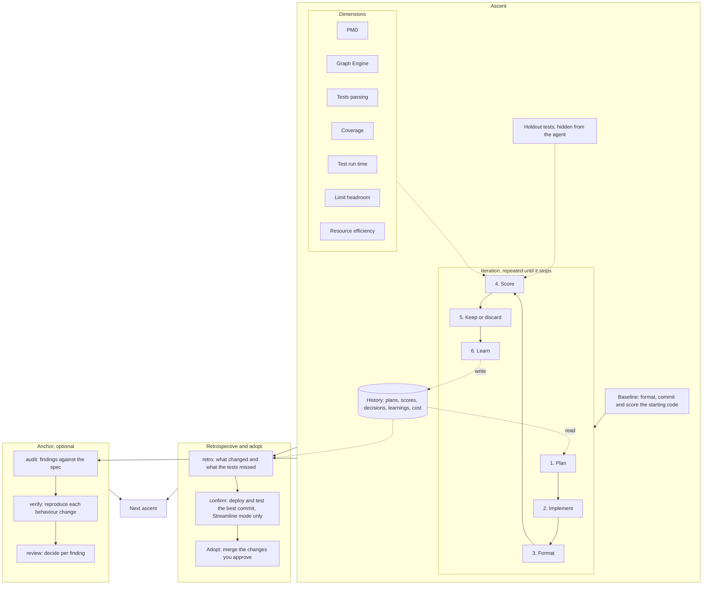

# How it works

- **Ascent:** one climb of one or more classes, on its own branch and worktree, in [deploy or Streamline mode](glossary.md). It ends at the summit, or after too many discards in a row. You can run as many ascents as you like, each with its own name. See [the CLIs](clis.md#ascent-init).
- **Baseline:** the scores of the starting code. Every candidate is compared against the best kept scores so far.
- **Iteration:** one attempt at one small change. One `iterate` call runs one iteration. See [iterate](clis.md#iterate).
- **Steps:** plan, implement and learn are agent steps. The ascent config sets each one's model and command. Format, score and keep or discard are fixed code. See [Agent step](glossary.md).
- **Format:** Prettier formats the application classes before every score, the baseline included. Line coverage counts lines, so without it a candidate could raise coverage by packing statements onto one line. Ternaries and `&&`/`||` chains still stay on one line. See [Tests](scoring.md#tests).
- **Dimensions:** the score step runs the tools and turns each one's output into a score from 0 to 100. Their weights are set in the ascent config. See [Scoring](scoring.md).
- **Holdout tests:** test classes the plan and implement steps never see. They run and score with the visible tests, so a change that only satisfies the tests the agent can read still fails. See [Holdout](glossary.md) and [Benefits](benefits.md#2-objective-scoring-no-self-grading).
- **History:** `history.jsonl` in the ascent directory, outside git, with one entry per iteration: the plan, scores, decision, learning and each step's cost. Later plan steps read the learnings instead of earlier transcripts, and the report and retrospective are built from it. See [Files overview](../README.md#files-overview) and [Benefits](benefits.md#7-learning-accumulates-context-does-not).
- **Keep or discard:** a kept candidate becomes a commit on the ascent branch and a discarded one is reset. See [Keep / discard](glossary.md) and [Benefits](benefits.md).
- **Retrospective:** after the ascent, `retro` lists what changed and what the tests missed. In Streamline mode, `confirm` deploys and checks the best commit too. See [retro](clis.md#retro).
- **Adopt or anchor:** adopt merges the changes you approve. [Anchor](anchor.md#anchor) treats the ascent as a scout: audit finds where the code drifted from the spec, verify reproduces each behaviour change, and you decide per finding on the review page. Applying those decisions to the tests and spec is not built yet. Either path leads to the next ascent, which scores a new baseline.
- **Map:** before any ascent, [mapping](mapping.md) scores every group of classes on the same dimensions to show where to climb.
- **Safety:** what each of these changes in your org and repo is in [Is it safe?](is-it-safe.md).
