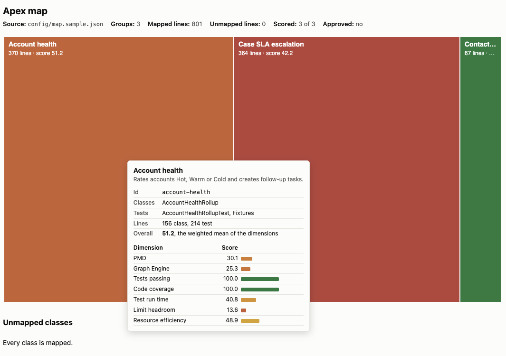
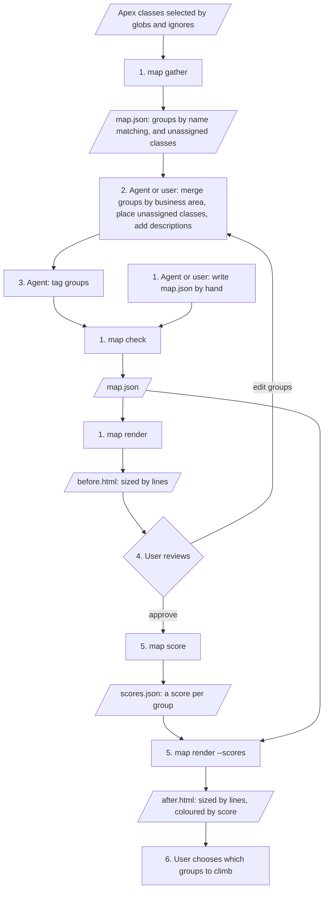

# Mapping

Mapping charts the landscape of an org's Apex codebase as a treemap. Each group of classes and tests is a rectangle sized by its lines of code and coloured by its score. A large red rectangle is a lot of code scoring poorly, which is where climbing is likely to pay off most. It has been tested on the three sample classes and on one real org with 55 groups.



The scored map of the three sample classes. Hovering a group shows its classes, tests, line counts and the score of each dimension.

## Process

Steps to map a repo. To map another repo, run them from climber with `--root` pointing at that repo.

1. **Gather.** Create `map.json`, then run `map check` and `map render`.
   - `map gather` selects the Apex files to map and groups them by class name only, with no agent, as a first pass for refining. See [Default grouping](#default-grouping).
   - Tests and fixtures that several groups use land in `unassigned`.
   - Generated code can dominate the chart.
   - Instead, an agent or the user can write `map.json` by hand, following the [schema](#mapjson). A map without `source` still works, but the unmapped classes table then only finds classes in folders that hold a mapped class.
   - `map check` validates the map, however it was created.
   - `map render` writes `before.html`, a treemap. Each rectangle is a group, its area is the non-blank lines, comments included, in the group's classes and tests, and together the rectangles fill one outer rectangle that stands for the whole org.
2. **Refine.** An agent or the user edits `map.json`: placing each unassigned class in the group whose code it tests, merging groups by business area and adding descriptions. Classes that are unclear stay in `unassigned`.
   - Shared test utilities go in a `testing` group. It is infrastructure: scored on static analysis only and not climbed.
   - A fixture that only one group's tests use goes in that group's `fixtures`.
3. **Tag.** The user names facets, such as version or business area, and an agent infers each group's value from the code. See [Tagging](#tagging).
   - The agent sets a value it can't infer to `unknown` rather than guessing.
   - Each tag renders as a coloured pill. Clicking one fades the groups without that tag, and Clear at the top right resets the filter.
4. **Approve.** The user reviews `before.html`, corrects the grouping and approves the map by setting `"approved": true` in `map.json`. An approved map has no unassigned classes.
5. **Score.** Run `map score <name> -o <org>`, then `map render <name> --scores`. See [Scoring](#scoring).
   - Each group is scored with the same dimensions and weights as an ascent baseline.
   - `map score` runs the map's test classes, PMD and Graph Engine once against the code already in the org, then slices the outputs per group.
   - Scoring again after regrouping reuses the run without calling the org. `--fresh` runs it again.
   - `after.html` colours each rectangle by its group's overall score, from green at 100 to red at the lowest group score.
6. **Choose.** The user uses the chart to pick the groups worth climbing.



## Commands

Each command takes the map's name, like the ascent CLIs, and works in the map's folder (see [Output naming](#output-naming)).

| Command | Reads | Writes |
|---|---|---|
| `map gather <name> <globs...> [-i <globs...>]` | the class files the globs select | `map.json` |
| `map check <name>` | the map and the class files | nothing, prints any errors |
| `map render <name>` | the map and the class files | `before.html` |
| `map score <name> -o <org>` | the map, the class files and the org | `scores.json` |
| `map render <name> --scores` | the map, the class files and the scores | `after.html` |

- `map gather` selects `.cls` files with include globs, then drops any that match an `-i, --ignore` glob. Globs are relative to `--root`, which defaults to the current folder. For example, `map gather sales 'force-app/**/classes/*.cls' -i '**/*Mock*.cls'`. It groups them as [Default grouping](#default-grouping) describes. The map records the root and globs it was gathered from, so it can be gathered again the same way.
- `map check` validates the map against the schema, which rejects a class in two groups and an approved map with unassigned classes, and checks that every class it names exists exactly once under the root. `map render` and `map score` run the same checks first.
- `map render` never writes to the map file. Line counts are worked out on every render.
- `map score` refuses a map that isn't approved. It collects its inputs once for the whole map and slices them per group, as [Scoring](#scoring) describes.
- `map render --scores` warns when a group's classes or tests differ from the ones it was scored with.

### Quoting globs

Quote each glob so `map gather` receives the glob itself and records it in the map. Use single quotes in bash, zsh and PowerShell, and double quotes in cmd.exe. `map gather` accepts `\` as well as `/`, and drops the single quotes cmd.exe passes on.

| Shell | Unquoted glob |
|---|---|
| bash | Passed on unchanged when it matches nothing. Without `globstar`, `**` acts as `*`. With `globstar`, it is expanded into files. |
| zsh | Expanded into files. With no match, zsh stops with `no matches found` before `map gather` runs. |
| PowerShell, cmd.exe | Passed on unchanged |

Files from an expanded glob gather the same groups, but the map records the files instead of the glob, so a later gather misses new classes. `map gather` warns when an argument names a file and holds no glob characters.

## Default grouping

`map gather` groups the selected classes with these rules, in order:

1. A class with an `@isTest` annotation outside comments is a test class. Every other class is an app class.
2. Each app class starts its own group. The group's id is the class name in kebab case, such as `account-health-rollup`, and its name is the class name.
3. A test class joins the group of the app class whose name it matches once a `Test` prefix or suffix is removed, with or without an underscore, ignoring case: `FooTest`, `Foo_Test`, `TestFoo` and `Test_Foo` all match `Foo`.
4. An app class that no test is named after, and that only test classes refer to, is a fixture. When all of those test classes belong to one group, it moves into that group's `fixtures`, and the group it started is dropped. References are matched case-sensitively, so a variable named `fixtures` doesn't count as a reference to `Fixtures`.
5. Anything left over goes in `unassigned`: test classes that match no app class, and fixtures used by tests in several groups.

The agent or user then places the unassigned classes, merges groups that belong to one business area, and adds descriptions. `map check` accepts a map with unassigned classes, but approving the map requires that none are left.

## Output naming

Each map gets its own folder, `target/map/<name>/`:

```text
target/map/<name>/
├── map.json         map gather
├── run/             map score: the raw outputs of one test and analyzer run
├── runs/<id>/       map score: each group's slice of run/
├── scores.json      map score
├── before.html      map render
└── after.html       map render --scores
```

`--map <file>` on `render` and `score` reads a map from elsewhere, such as the committed `config/map.sample.json`, while the outputs still go to the named folder.

## Scoring

`map score` scores every group in one command, so an agent runs it once rather than once per group. It runs the tests already in the org and never deploys. It scores like a deploy-mode ascent, except that the tests running stands in for the deploy's compile gate.

- **One run, sliced per group.** The test run covers only the approved map's test classes, so you can map one area of a large org without running every test. PMD and Graph Engine run once over all mapped classes, and each violation goes to the group that holds its file.
- **Coverage.** The run uses `--code-coverage --detailed-coverage`, so a group's coverage is the union of the lines its own tests cover. Coverage from other groups' tests never counts.
- **Tests passing and run time** come from the group's test classes' method results, including their setup methods.
- **Limits.** The org writes one debug log per test class, and each log goes to the group that owns its test class. Logs are fetched by id, several at a time, because `sf apex get log --number` stops at 25. Test names drop any namespace prefix, so `ns.ClassTest.method` counts as `ClassTest.method` in a namespaced org.
- **Best effort.** A dimension a group can't be scored on, such as limit headroom without a headroom test, or every test dimension for a group without tests, gets weight 0 for that group. Its entry in `scores.json` lists the skipped dimensions.
- **Reuse.** The raw outputs stay in `target/map/<name>/run/`. Scoring again after regrouping slices them again without calling the org, and `--fresh` collects them again.
- `map score` creates the analyzer log folder that `code-analyzer.yml` names, `target/tmp/code-analyzer/logs`, under the target repo's root.

Measured on an org with 308 tests in 41 test classes and 55 groups:

| Step | Wall-clock |
|---|---|
| Tests with detailed coverage | 40 s |
| 41 logs, fetched 8 at a time | 13 s |
| PMD over 54 classes | 5 s, 81 s on a cold first run |
| Graph Engine over 54 classes | 7 s |

Two limits apply:

- Graph Engine can fail on some entry points with an internal error. Those entry points report no violations, the same as in a per-group run.
- Test classes run in parallel in one job, so run times can differ from a group's tests run alone.

## map.json

The Zod schema `ProjectMap` in `cli/lib/map.ts` defines the file, and every map command reads and writes it through that schema. `config/map.sample.json` maps the three sample classes. `headroomTest` is optional.

The file holds only what the agent and user decide: the groups. Line counts are worked out on each render, and scores live in `scores.json`.

Each group has an `id`, a kebab-case slug set when the group is created, by `map gather` from the class name or by whoever adds the group. Ids are unique and never change, so renaming a group or moving classes between groups keeps its score attached.

### Tagging

Tagging is optional. A group's `tags` holds one value per facet, such as `{ "version": "v3", "area": "rendering" }`, so each facet is one way to categorise the groups. The user names the facets and an agent infers their values from the code. The page gives each tag its own colour and shows it as a pill on each rectangle and in the hover. Clicking a pill fades every group without that tag. The filter shows at the top right, with Clear to reset it. While a filter is on, a checkbox below it hides those groups instead of fading them and lays the treemap out again with the remaining groups.

```json
{
  "approved": false,
  "source": { "root": ".", "include": ["force-app/**/classes/*.cls"], "ignore": [] },
  "unassigned": [],
  "groups": [
    {
      "id": "account-health",
      "name": "Account health",
      "description": "Rates accounts and creates follow-up tasks.",
      "classes": ["AccountHealthRollup"],
      "tests": ["AccountHealthRollupTest"],
      "fixtures": ["Fixtures"],
      "headroomTest": "AccountHealthRollupTest.headroomAt200Accounts"
    }
  ]
}
```

## scores.json

A `MapScores` schema defines the file, keyed by group id. Each entry records the classes and tests it scored, so a later render can tell when the group has changed.

```json
{
  "account-health": {
    "overall": 51.7,
    "dimensions": { "PMD": 40, "Code coverage": 91.2 },
    "skipped": [],
    "classes": ["AccountHealthRollup"],
    "tests": ["AccountHealthRollupTest", "Fixtures"],
    "run": "target/map/map.sample/runs/account-health",
    "scoredAt": "2026-11-02T16:00:00.000Z"
  }
}
```

## Treemap

Each group is one flat rectangle. Its classes and tests are listed in the hover, not drawn as nested rectangles. Before scoring, rectangles share one neutral colour.

The chart is a Vega spec, since Vega has a treemap transform and Vega-Lite does not. It uses Vega 5.30.0, the version the ascent report loads.

## Unmapped classes

Below the treemap, both pages list every Apex class that isn't in a group, so the chart's coverage of the codebase is visible. `map render` finds them in two places:

- the files the map's `source` globs select, plus the files its ignore globs drop
- every `.cls` file in a folder that holds a mapped class, which covers maps written by hand without a `source`

| Column | Content |
|---|---|
| Class | the class name |
| Path | the file, relative to the root |
| Kind | app or test, by the `@isTest` rule in [Default grouping](#default-grouping) |
| Lines | non-blank lines |
| Reason | `unassigned`: in the map's `unassigned` list. `ignored`: dropped by an ignore glob. `not in map`: found by the globs or in a mapped folder, but in no group, such as a class added since the map was gathered |

The page header shows mapped and unmapped line totals. When every class is mapped, the table says so.

## Assumptions and side effects

Mapping reads the class files in the repo only. Classes that exist in the org but not in the repo don't appear on the map.

Mapping assumes the source it reads has been deployed to the org it scores. Deploying is the user's job, not mapping's. If the source and the org differ, PMD and Graph Engine score the local files while the tests run the org's code, and a group's score mixes the two.

Mapping makes no changes to code, metadata or business data. Its only side effects come from running tests:

- Apex tests roll back their data. The org keeps the test results and updates its stored code coverage.
- Reading limit use needs debug logs, so scoring creates or updates a `DebugLevel` and a `TraceFlag` for the running user. The org keeps the resulting `ApexLog` records.
