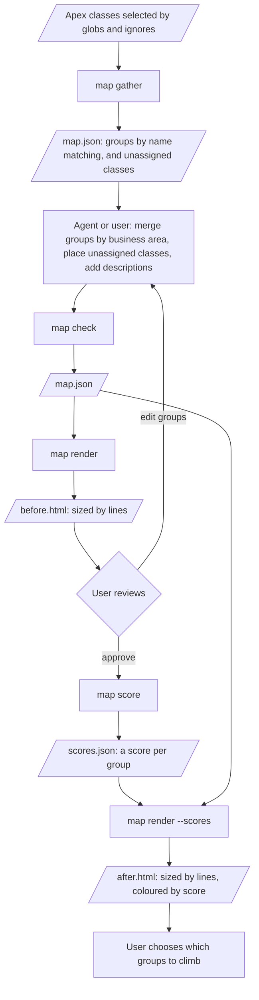

# Mapping

**Maturity: early.** The [commands](#commands) below are built and tested against the three sample classes only.

Mapping charts the landscape of an org's Apex codebase as a treemap. Each group of classes and tests is a rectangle sized by its lines of code and coloured by its score. A large red rectangle is a lot of code scoring poorly, which is where climbing is likely to pay off most.

## Process



1. **Gather.** `map gather` selects the Apex files to map and groups them by name, with no agent. See [Default grouping](#default-grouping).
2. **Refine.** An agent or the user edits `map.json`: merging groups by business area, placing unassigned classes and adding descriptions. An agent should start from the output of `map gather` rather than write the map from scratch, since gathering is fast and repeatable. `map check` validates the edited map.
3. **Render.** `map render` counts the non-blank lines in each group's classes and tests and draws the groups as a treemap. Each rectangle is a group, its area is the group's lines of code, and together the rectangles fill one outer rectangle that stands for the whole org.
4. **Approve.** The user corrects the grouping and approves the map.
5. **Score.** `map score` scores each group with the same dimensions and weights as an ascent baseline.
6. **Colour.** `map render --scores` colours each rectangle by its group's overall score, from green at 100 to red at the lowest group score.
7. **Choose.** The user uses the chart to pick the groups worth climbing.

## Commands

Each command takes the map's name, like the ascent CLIs, and works in the map's folder (see [Output naming](#output-naming)).

| Command | Reads | Writes |
|---|---|---|
| `map gather <name> <globs...> [-i <globs...>]` | the class files the globs select | `map.json` |
| `map check <name>` | the map and the class files | nothing, prints any errors |
| `map render <name>` | the map and the class files | `before.html` |
| `map score <name> -o <org>` | the map, the class files and the org | `scores.json` |
| `map render <name> --scores` | the map, the class files and the scores | `after.html` |

- `map gather` selects `.cls` files with include globs, then drops any that match an `-i, --ignore` glob. Globs are relative to `--root`, which defaults to the current folder. For example, `map gather sales 'force-app/**/classes/*.cls' -i '**/*Mock*.cls'`. It groups them as [Default grouping](#default-grouping) describes. The map records the root and globs it was gathered from, so it can be gathered again the same way.
- `map check` validates the map against the schema, which rejects a class in two groups and an approved map with unassigned classes, and checks that every class it names exists exactly once under the root. `map render` and `map score` run the same checks first.
- `map render` never writes to the map file. Line counts are worked out on every render.
- `map score` scores the groups one at a time, largest first. It saves `scores.json` after each group and skips groups it already holds, so an interrupted pass resumes where it stopped.
- `map render --scores` warns when a group's classes or tests differ from the ones it was scored with.

### Quoting globs

Quote each glob so `map gather` receives the glob itself and records it in the map. Use single quotes in bash, zsh and PowerShell, and double quotes in cmd.exe. `map gather` accepts `\` as well as `/`, and drops the single quotes cmd.exe passes on.

| Shell | Unquoted glob |
|---|---|
| bash | Passed on unchanged when it matches nothing. Without `globstar`, `**` acts as `*`. With `globstar`, it is expanded into files. |
| zsh | Expanded into files. With no match, zsh stops with `no matches found` before `map gather` runs. |
| PowerShell, cmd.exe | Passed on unchanged |

Files from an expanded glob gather the same groups, but the map records the files instead of the glob, so a later gather misses new classes. `map gather` warns when an argument names a file and holds no glob characters.

## Default grouping

`map gather` groups the selected classes with these rules, in order:

1. A class with an `@isTest` annotation outside comments is a test class. Every other class is an app class.
2. Each app class starts its own group. The group's id is the class name in kebab case, such as `account-health-rollup`, and its name is the class name.
3. A test class joins the group of the app class whose name it matches once a `Test` prefix or suffix is removed, with or without an underscore, ignoring case: `FooTest`, `Foo_Test`, `TestFoo` and `Test_Foo` all match `Foo`.
4. An app class that no test is named after, and that only test classes refer to, is a fixture. When all of those test classes belong to one group, it moves into that group's `fixtures`, and the group it started is dropped. References are matched case-sensitively, so a variable named `fixtures` doesn't count as a reference to `Fixtures`.
5. Anything left over goes in `unassigned`: test classes that match no app class, and fixtures used by tests in several groups.

The agent or user then places the unassigned classes, merges groups that belong to one business area, and adds descriptions. `map check` accepts a map with unassigned classes, but approving the map requires that none are left.

## Output naming

Each map gets its own folder, `target/map/<name>/`:

```text
target/map/<name>/
├── map.json         map gather
├── scores.json      map score
├── before.html      map render
└── after.html       map render --scores
```

`--map <file>` on `render` and `score` reads a map from elsewhere, such as the committed `config/map.sample.json`, while the outputs still go to the named folder.

## Decisions

- D1: Zod schemas define the map and the scores files, and every mapping tool reads and writes them through those schemas.
- D2: Each group has an `id`: a kebab-case slug set when the group is created, by `map gather` from the class name or by whoever adds the group. The schema requires ids to be unique. An id never changes, so renaming a group or moving classes between groups keeps its score attached.
- D3: Red marks the lowest group score, not 0.
- D4: Scoring is best effort. A dimension a group can't be scored on, such as limit headroom without a headroom test, gets weight 0 for that group, and the group's score records which dimensions it skipped.
- D5: Scoring runs the tests already in the org and never deploys. It scores like deploy mode, except that the tests running stands in for the deploy's compile gate. Speed doesn't matter.
- D6: One command, `map score`, scores every group in turn. It replaces the agent-driven loop of `map next` and `map set-score`.
- D7: The map file holds only what the agent and user decide: the groups. Line counts are derived on render, and scores live in `scores.json`.

## map.json

The Zod schema `ProjectMap` in `cli/lib/map.ts` defines the file. `config/map.sample.json` maps the three sample classes. `headroomTest` is optional.

```json
{
  "approved": false,
  "source": { "root": ".", "include": ["force-app/**/classes/*.cls"], "ignore": [] },
  "unassigned": [],
  "groups": [
    {
      "id": "account-health",
      "name": "Account health",
      "description": "Rates accounts and creates follow-up tasks.",
      "classes": ["AccountHealthRollup"],
      "tests": ["AccountHealthRollupTest"],
      "fixtures": ["Fixtures"],
      "headroomTest": "AccountHealthRollupTest.headroomAt200Accounts"
    }
  ]
}
```

## scores.json

A `MapScores` schema defines the file, keyed by group id. Each entry records the classes and tests it scored, so a later render can tell when the group has changed.

```json
{
  "account-health": {
    "overall": 51.7,
    "dimensions": { "PMD": 40, "Code coverage": 91.2 },
    "skipped": [],
    "classes": ["AccountHealthRollup"],
    "tests": ["AccountHealthRollupTest", "Fixtures"],
    "run": "target/map/map.sample/runs/account-health",
    "scoredAt": "2026-11-02T16:00:00.000Z"
  }
}
```

## Treemap

Vega has a treemap transform. Vega-Lite does not, so the chart is a Vega spec. The report page already loads Vega 5.30.0. Before scoring, rectangles share one neutral colour.

## Unmapped classes

Below the treemap, both pages list every Apex class that isn't in a group, so the chart's coverage of the codebase is visible. `map render` finds them in two places:

- the files the map's `source` globs select, plus the files its ignore globs drop
- every `.cls` file in a folder that holds a mapped class, which covers maps written by hand without a `source`

| Column | Content |
|---|---|
| Class | the class name |
| Path | the file, relative to the root |
| Kind | app or test, by the `@isTest` rule in [Default grouping](#default-grouping) |
| Lines | non-blank lines |
| Reason | `unassigned`: in the map's `unassigned` list. `ignored`: dropped by an ignore glob. `not in map`: found by the globs or in a mapped folder, but in no group, such as a class added since the map was gathered |

The page header shows mapped and unmapped line totals. When every class is mapped, the table says so.

## Assumptions and side effects

Mapping assumes the source it reads has been deployed to the org it scores. Deploying is the user's job, not mapping's. If the source and the org differ, PMD and Graph Engine score the local files while the tests run the org's code, and a group's score mixes the two.

Mapping makes no changes to code, metadata or business data. Its only side effects come from running tests:

- Apex tests roll back their data. The org keeps the test results and updates its stored code coverage.
- Reading limit use needs debug logs, so scoring creates or updates a `DebugLevel` and a `TraceFlag` for the running user. The org keeps the resulting `ApexLog` records.

## Open questions

- Q2: Do rectangles nest, with groups split into classes and tests or into individual classes, or is each group one flat rectangle?
- Q3: Should line counts also exclude comments? They exclude blank lines now.
- Q4: A class used by several groups, such as a shared fixture or service: does it belong to one group, or is it counted in each?
- Q5: Does mapping read the repo's source only, or also the org, for classes that aren't in the repo?
